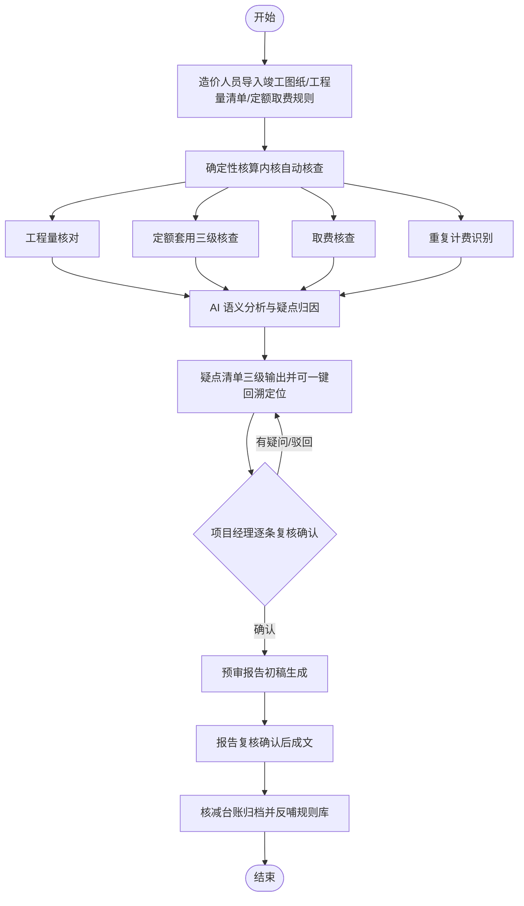

# 中国联通业务需求说明书
## 通信工程造价结算 AI 预审分析工具建设

> **提出人：陈翱（联系电话15657670523、邮箱chena9@chinaunicom.cn）**
> **提出人所在单位：中国联通台州市分公司**
> **编制日期：2026年11月13日**

### 文档修订历史

| 序号 | 修订章节 | 修订类型 | 修订内容 | 修订人 | 修订日期 | 审核负责人 | 备注 |
| --- | --- | --- | --- | --- | --- | --- | --- |
| 1 | 全部 | 新增 | 首次发布 | 陈翱 | 2026.11.13 |  |  |

# 1 需求名称

通信工程造价结算 AI 预审分析工具建设

# 2 适用范围

本需求面向通信工程建设项目的竣工结算预审环节，引入 AI 预审分析工具，实现造价人员与 AI 协同开展结算预审。

上线地理范围：全省范围推广使用，分三期推进。一期在通信线路、设备安装两类典型工程先行交付基础试用版；二期在 3 至 5 个试点项目投产验证；三期面向全省统一推广并沉淀全省造价预审标准库。

影响范围：覆盖通信建设工程竣工结算送审前预审业务条线，涉及结算预审核对、疑点复核确认、预审报告成文及核减复盘等环节。

角色范围：工程造价人员、项目经理（预审复核确认）等角色，其中项目经理担任预审复核确认与资料把关责任。

前端触点：PC 端 AI 预审分析工具。

# 3 需求背景与目标

## 3.1 业务现状与痛点

通信建设工程竣工结算送审前，要求项目经理开展结算预审，需对照竣工图纸逐项核对工程量清单、定额套用、取费标准等全部内容，完成资料把关后再提交审计。

当前业务面临以下痛点：

- 项目经理人手紧张且多项目并行管理、现场事务繁重，送审阶段全量资料依靠人工复核任务重、预审压力大，可投入结算预审的时间有限。
- 工程量清单、竣工图纸、定额取费等资料数据庞大，人工逐条核对效率低，容易出现错算、定额错套等问题。
- 缺少 AI 辅助核查工具，复核质量依赖个人经验，标准不统一。
- 预审把关不到位，容易造成送审后被审计核减、资料退回整改，加长结算周期。

## 3.2 需求目标

开发工程造价审计预审 AI 分析工具，实现人机协同预审：导入竣工图纸、工程量清单及定额规则，由 AI 自动解析图纸数据、比对核查清单工程量、定额及取费的准确性，自动识别并输出疑点清单、生成预审报告供项目经理人工复核确认，从而有效减少人工重复核对工作量、统一预审标准、提升送审资料质量，减少退审整改、缩短结算周期。

分三期建设并设定量化目标：

- 一期：交付基础试用版，打通清单导入、定额推荐、取费核算、疑点清单导出与报告初稿生成主链路，实现清单可解析率不低于 95%、定额推荐前三名命中率不低于 85%、单项目预审耗时下降约 30%。
- 二期：聚焦核查模型精度，实现图纸与清单工程量自动核对覆盖可结构化分项 80% 以上，疑点召回率不低于 85%、误报率控制在 20% 以内，预审报告初稿 10 分钟内生成、项目经理复核工时压减 50%，并在 3 至 5 个试点项目投产验证，推动首次送审退审整改次数下降 30%。
- 三期：实现与结算审计流程贯通、预审结果自动归档复盘，沉淀不少于 500 条全省统一的造价预审标准条目与口径，并向设计概算、施工图预算等前段阶段延伸。

# 4 需求内容描述

本需求构建一套“确定性核算内核与 AI 语义判断双轨并行”的通信工程造价结算 AI 预审分析工具。确定性核算内核负责算得准，对竣工图 CAD 做矢量解析、对工程量清单做标准化，并按三级规则完成定额套用与取费检核、跨比对识别重复计费；大模型负责图纸与清单的语义对齐、疑点归因解释和报告成文。核查结果按高、中、低三级输出疑点清单，每条可一键回溯至图纸图元位置或清单行号，形成“疑点输出—项目经理复核确认—报告初稿成文—核减台账归档反哺规则库”的闭环。

## 4.1 需求点清单

| 序号 | 需求点名称 | 需求点描述 | 优先级 | 涉及系统/触点 |
| --- | --- | --- | --- | --- |
| 1 | 工程资料导入与解析 | 导入竣工图纸、工程量清单、定额规则及取费标准，完成标准化处理 | 高 | PC 端工具 |
| 2 | 工程量自动核对 | 比对核查清单工程量与图纸量算结果的准确性 | 高 | PC 端工具 |
| 3 | 定额套用检核 | 按三级匹配核查定额套用的准确性 | 高 | PC 端工具 |
| 4 | 取费检核 | 核查取费基数、费率与工程类别是否匹配 | 高 | PC 端工具 |
| 5 | AI 语义分析 | 大模型完成图纸与清单语义对齐、疑点归因解释和报告成文 | 高 | PC 端工具 |
| 6 | 疑点清单输出 | 按高/中/低三级输出疑点清单并支持一键回溯定位 | 高 | PC 端工具 |
| 7 | 预审报告生成 | 生成预审报告初稿供项目经理复核确认 | 高 | PC 端工具 |
| 8 | 预审闭环与标准库 | 核减台账归档反哺规则库，沉淀全省造价预审标准库，扩展至全阶段核查 | 中 | PC 端工具 |

## 4.2 工程资料导入模块

面向造价人员提供工程资料导入与标准化能力：

- 竣工图纸解析：对竣工图 CAD 做矢量解析，直接读取图层、块属性和标注，自动量算工程量，不依赖仅靠识别的图像判断。
- 工程量清单导入与标准化：导入工程量清单并标准化，抽取编码与项目特征，为后续核对提供基础数据。
- 定额规则及取费标准导入：导入现行通信工程定额规则与取费标准并入库维护。

## 4.3 自动核查模块（确定性核算内核）

面向造价人员的预审核对环节，提供自动核查能力：

- 定额套用核查：按“精确匹配、特征语义召回、换算系数校验”三级完成定额套用核查。
- 取费核查：依据现行通信工程费用定额建立取费规则引擎，核查取费基数、费率与工程类别是否匹配。
- 工程量核对：通过跨清单项、跨单位工程比对，核对图纸与清单工程量。
- 重复计费识别：识别重复计费与主辅材重复计列等风险点。

## 4.4 AI 语义分析模块

- 图纸与清单语义对齐：大模型负责图纸与清单数据的语义对齐，辅助核对与归因。
- 疑点归因解释：对自动核查发现的疑点给出归因解释。
- 报告成文：大模型辅助生成预审报告初稿。
- 权限边界约束：大模型不直接修改金额、不直接下结论，结论由项目经理复核确认。

## 4.5 疑点清单与报告模块

- 疑点清单输出：核查结果按高、中、低三级输出偏差、错套、重复计费等风险点。
- 一键回溯定位：每条疑点可一键回溯至图纸图元位置或清单行号。
- 复核确认：项目经理对疑点与报告初稿进行复核确认。
- 报告初稿生成：自动生成预审报告初稿供项目经理复核修改后成文。

## 4.6 预审闭环与标准库模块

- 核减台账归档：将预审核减情况归档形成台账。
- 规则库反哺：归档结果反哺规则库，持续提升准确率。
- 全省预审标准库：沉淀不少于 500 条全省统一的造价预审标准条目与口径，统一预审口径。
- 全阶段扩展：三期扩展至设计概算、施工图预算等全阶段造价 AI 核查。

# 5 业务流程

本需求实现“导入资料—自动核查—AI 语义分析—疑点复核—报告成文—台账归档反哺”的预审闭环业务流程。造价人员导入工程资料后，确定性核算内核完成工程量、定额、取费的自动核查，大模型完成语义对齐与疑点归因；核查结果输出为高、中、低三级疑点清单，交由项目经理逐条复核确认，确认后生成预审报告初稿；报告成文后核减情况归档形成台账，并反哺规则库持续改进。

流程关键节点说明：

1. 工程资料导入：造价人员导入竣工图纸、工程量清单及定额取费规则，系统完成 CAD 矢量解析与清单标准化。
2. 自动核查：确定性核算内核依据规则完成工程量核对、定额套用三级核查、取费核查及重复计费识别。
3. AI 语义分析：大模型完成图纸与清单语义对齐、疑点归因解释，但不对金额与结论直接定论。
4. 疑点复核确认：项目经理对疑点清单逐条复核，有疑问的予以驳回处理，确认后生成报告。
5. 台账归档与反馈：报告成文后核减台账归档，并反哺规则库用于持续优化。

# 6 业务规则

| 序号 | 规则名称 | 规则描述 |
| --- | --- | --- |
| 1 | 定额套用三级匹配 | 按“精确匹配、特征语义召回、换算系数校验”三级完成定额套用核查 |
| 2 | 取费检核 | 依据现行通信工程费用定额建立取费规则引擎，核查取费基数、费率与工程类别是否匹配 |
| 3 | 工程量核对 | 通过跨清单项、跨单位工程比对，核对图纸与清单工程量，识别重复计费与主辅材重复计列 |
| 4 | 大模型权限边界 | 大模型只负责图纸与清单语义对齐、疑点归因解释和报告成文，不直接修改金额、不下结论 |
| 5 | 疑点分级输出 | 核查结果按高、中、低三级输出疑点清单，每条可一键回溯至图纸图元位置或清单行号 |
| 6 | 疑点输出约束 | 坚持“宁可少报不可乱报”，误报率控制在 20% 以内，确保工具被造价人员采信 |
| 7 | 试点与投产 | 二期在 3 至 5 个试点项目投产验证，收集反馈并迭代优化 |

# 7 数据需求

## 7.1 数据项与报表

本需求涉及的主要数据实体包括：竣工图纸（CAD 矢量数据）、标准化工程量清单（含编码与项目特征）、定额规则库、取费标准库、疑点清单、预审报告、核减台账、全省造价预审标准库。

报表需求：疑点清单报表（按高/中/低分级展示）、预审报告、核减台账统计（支撑复核确认与复盘归档）。

## 7.2 数据埋点

附件未涉及，本节内容待补充。

# 8 非功能需求

## 8.1 性能要求

- 清单可解析率不低于 95%。
- 定额推荐前三名命中率不低于 85%。
- 图纸与清单工程量自动核对覆盖可结构化分项 80% 以上。
- 疑点召回率不低于 85%、误报率控制在 20% 以内。
- 预审报告初稿 10 分钟内生成。
- 单项目预审耗时下降约 30%，项目经理复核工时压减 50%。

## 8.2 安全要求

附件未涉及，本节内容待补充。

## 8.3 可用性要求

附件未涉及，本节内容待补充。

# 9 验收要点

| 序号 | 验收场景 | 验收标准 |
| --- | --- | --- |
| 1 | 基础试用版交付 | 一期交付基础试用版，打通清单导入、定额推荐、取费核算、疑点清单导出与报告初稿生成主链路，覆盖通信线路、设备安装两类典型工程 |
| 2 | 清单解析 | 清单可解析率不低于 95% |
| 3 | 定额推荐 | 定额推荐前三名命中率不低于 85% |
| 4 | 工程量核对覆盖 | 图纸与清单工程量自动核对覆盖可结构化分项 80% 以上 |
| 5 | 疑点召回与误报 | 疑点召回率不低于 85%、误报率控制在 20% 以内 |
| 6 | 报告生成时效 | 预审报告初稿 10 分钟内生成 |
| 7 | 预审效率 | 单项目预审耗时下降约 30% |
| 8 | 复核工时 | 项目经理复核工时压减 50% |
| 9 | 退审整改 | 推动首次送审退审整改次数下降 30% |
| 10 | 试点投产 | 在 3 至 5 个试点项目投产验证并收集反馈迭代 |
| 11 | 标准库沉淀 | 沉淀不少于 500 条全省统一造价预审标准条目与口径 |
| 12 | 全阶段扩展 | 预审结果自动归档复盘，并向设计概算、施工图预算等前段阶段延伸 |

# 10 附录

## 10.1 名词术语

| 术语 | 说明 |
| --- | --- |
| 结算预审 | 通信建设工程竣工结算送审前，对工程量清单、定额套用、取费标准等进行预先审查，完成资料把关后提交审计 |
| 工程量清单 | 载明工程分项、数量及项目特征的清单，是结算计价的基础文件 |
| 定额套用 | 依据通信工程定额标准，确定清单项对应的定额子目 |
| 取费 | 依据费用定额，核算工程类别对应费率及相关费用的过程 |
| CAD 矢量解析 | 对竣工图 CAD 的图层、块属性和标注进行解析并自动量算工程量 |
| 疑点清单 | 核查发现的偏差、错套、重复计费等风险点清单，按高、中、低三级输出 |
| 核减台账 | 记录预审核减情况及结果的归档台账 |
| 双轨并行 | 确定性核算内核与 AI 语义判断并行协作的技术架构 |

## 10.2 参考资料

附件未提供具体参考资料，待补充。
